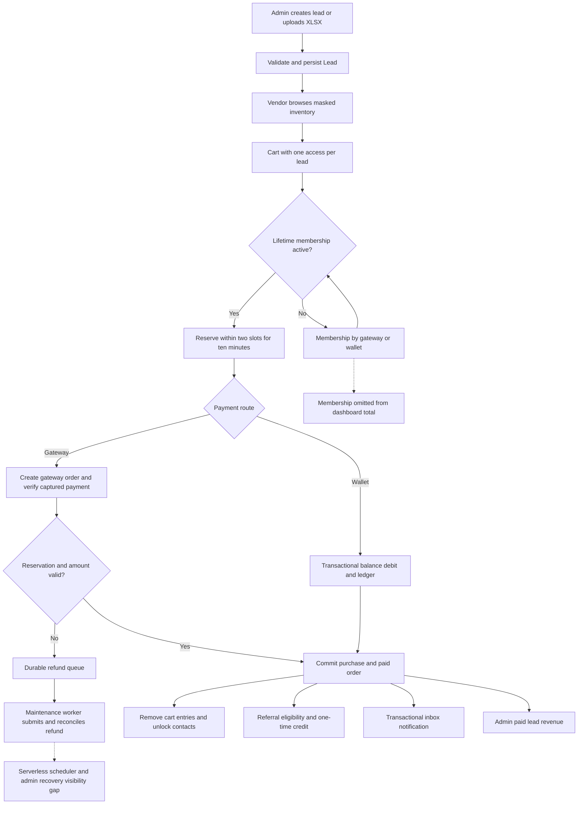

# Second end-to-end business workflow audit — NextLeads

Date: October 29, 2026 (Asia/Kolkata). Scope: this repository checkout, not a certification of the deployed service. Read-only audit: no application source fixes, production database access, real payments, outbound announcements, or production configuration changes.

## 1. Executive summary

**The complete lead-to-revenue workflow is not ready for production sign-off.** Core inventory and wallet transactions are substantially implemented and survive the executed concurrency tests. Operational recovery, complete financial reporting, admin visibility, and several validation paths remain incomplete or broken.

Across the **10 requested audit areas**, **2 are IMPLEMENTED at the local service/test level and 8 are PARTIALLY IMPLEMENTED**. No entire area is wholly MISSING; broken and missing subfeatures are identified individually below. IMPLEMENTED does not imply production acceptance. Production infrastructure, real provider behavior, browser acceptance, and mobile runtime are NOT VERIFIED.

Evidence from this execution:

- Existing backend suite: **169 PASS, 0 FAIL, 0 skipped**.
- Temporary isolated checks: **8 PASS**, including tests that deliberately assert and reproduce incorrect behavior. Five of those checks confirm product defects/limitations; green reproduction checks do not mean those features work correctly.
- Backend syntax/build check: PASS, 76 JavaScript files.
- Both web applications: production build PASS and lint PASS.
- Wallet race: three vendors concurrently buying the same lead resulted in exactly two allocations and two debits; the losing vendor retained their balance.
- Duplicate simultaneous wallet checkout: exactly one purchase and one debit.
- Confirmed admin lead detail fails with `ReferenceError: LeadPurchase is not defined`.
- Confirmed a partially refunded captured direct payment still allocates a lead.
- Confirmed lead edit accepts a nonexistent category, past expiry, and original price below sale price.
- Confirmed paid lead totals match isolated order/debit records, but wallet membership revenue is excluded from those totals.

Correction to the earlier admin audit: category reporting is **not universally broken for current-schema purchases**. Current leads lack a `buyers` array, so the paid-order fallback works. A temporary test verified both the successful fallback and the incorrect result when a legacy `buyers` array exists. Production presence of those legacy records is NOT VERIFIED.

### Inspection and evidence boundaries

Inspected Express app/router wiring; controller implementations; Mongoose Lead, Order, LeadPurchase, User, WalletEntry, WalletTopup, PaymentRefund, Referral, UploadLog and audit models; checkout/wallet/referral/import services; admin screens; user marketplace, lead detail, wallet, membership and header checkout screens; mobile cart repository/controller and source inventory; existing tests; configuration and maintenance startup.

The database is MongoDB/Mongoose, not Postgres/Supabase. Tests use disposable local MongoDB replica sets and synthetic accounts. Gateway operations in existing financial tests use mocks. No production connection string or secret values were printed. Live database indexes, financial balances, hosting settings, provider dashboard configuration, external scheduler and backups were not inspected. External package vulnerability scanning and full penetration testing were outside the executed checks.

## 2. Feature status matrix

Definitions: IMPLEMENTED = present and supported by executed local evidence for the stated scope; PARTIALLY IMPLEMENTED = main path exists with documented gaps; MISSING = no implementation found for the stated function; BROKEN = reproducible or directly evidenced defective behavior; NOT VERIFIED = no sufficient execution/deployment evidence.

| Requested area | Area status | Implemented evidence | Gaps / subfeature status |
|---|---|---|---|
| 1. Lead creation and bulk upload | PARTIALLY IMPLEMENTED | Admin guards, manual persistence, XLSX parsing, required fields, category lookup, expiry/phone checks, two-slot normalization, progress records | Edit validation BROKEN; deduplication MISSING; durable upload jobs MISSING; status authorization MISSING; database-failure accounting incomplete |
| 2. Vendor marketplace | PARTIALLY IMPLEMENTED | Listing/filter/detail/cart APIs, paid contact gating, current price at checkout, stale-cart checks, duplicate ownership rejection | Listing can include unavailable inventory; detail status can disagree with reservations; one buy path omits confirmed price; legacy ownership migration incomplete |
| 3. Wallet and payment | PARTIALLY IMPLEMENTED | HMAC checks, authoritative gateway fetches, transactional credit/debit/ledger, duplicate credit protection, insufficient balance checks | Direct-payment partial-refund guard MISSING; gateway-to-database linkage failure recovery incomplete; production reconciliation NOT VERIFIED |
| 4. Two-buyer limit | IMPLEMENTED | Conditional document writes and replica-set transactions; new-flow unique lead/user index; executed 3-buyer and existing 20-buyer tests | Enforced through application transaction protocol, not an independent database-wide maximum-two-purchases constraint; production indexes NOT VERIFIED |
| 5. Revenue and admin reporting | PARTIALLY IMPLEMENTED | Paid lead order revenue, monthly totals, recent paid orders; isolated lead total matches debit | Membership revenue MISSING from total; refund/topup breakdown MISSING; legacy category path BROKEN; paid-only history incomplete |
| 6. Refunds and failed transactions | PARTIALLY IMPLEMENTED | Durable PaymentRefund records, late-capture queuing, retry lock, mocked lost-response recovery, cumulative topup reversal and debt freeze | Serverless runner MISSING from repository wiring; direct purchase refund/dispute reconciliation MISSING; manual intervention UI MISSING |
| 7. Referral rewards | PARTIALLY IMPLEMENTED | Stable unique code, self/reciprocal checks, atomic qualification and credit, default 5000-paise reward, 10000-paise lifetime cap, reversal | REVIEW resolution/admin visibility MISSING; qualification is narrower than any paid purchase; production eligibility config NOT VERIFIED |
| 8. Admin control/visibility | PARTIALLY IMPLEMENTED | Inventory list, users/admins, paid orders, dashboard, categories/cities, support and notification inbox controls | Lead detail BROKEN; financial operations screens MISSING; new admin password setup incomplete; settings MISSING |
| 9. Security and integrity | PARTIALLY IMPLEMENTED | Auth/roles/MFA/session version, request validation, shared rate limits, signed webhook, transactional financial writes, signed append-only ledger | Public upload status; raw regex inputs; incomplete action auditing; destructive history loss; operational secrets/indexes NOT VERIFIED |
| 10. Automated business tests | IMPLEMENTED | 169 existing tests executed plus 8 temporary checks; builds/lint executed | Browser/mobile/provider/production acceptance NOT RUN; tests do not cover every failure mode |

Membership is a **one-time lifetime membership priced at ₹499**, from `backend/src/Config/membership.js:1`, not a recurring renewal plan. Referral reward is normally **₹50 per eligible referral, up to ₹100 lifetime**. Wallet funding is a balance liability, not automatically earned revenue; adding topups and wallet-funded purchases together would double count cash movement.

## 3. End-to-end workflow diagram

## 4. Detailed findings

All file paths below are repository-relative. Line numbers refer to the audited checkout. Severity: Critical/P0 = confirmed immediate uncontrolled funds/security failure; High/P1 = material financial/access/recovery exposure; Medium/P2 = incomplete correctness or operations; Low/P3 = presentation/clarity. No confirmed P0 exploit was demonstrated.

### F01 — High/P1: direct settlement accepts a partially refunded captured payment — BROKEN

- Location: `backend/src/Services/checkout.service.js:114`, `settleCapturedPayment`; amount/currency check at line 129. Contrast `backend/src/Services/wallet.service.js:19`, `creditCapturedTopup`, which rejects refunded amounts.
- Evidence: the direct settlement checks captured status, gross amount and currency, but never `amount_refunded`. Temporary check supplied amount 5000, refunded 1000 and status captured; result was PAID with one LeadPurchase. No real gateway interaction occurred.
- Impact: gross amount validation alone can grant full access despite a partial reversal. Signed/authentic payment data does not establish full retained funds.
- Recommended fix: define net-payment/refund eligibility, reject or reconcile any reversed payment before fulfillment, and test partial/full refunds plus out-of-order capture/refund events. Do not assume this test establishes live gateway event timing.

### F02 — High/P1: membership capture has no durable recovery path — PARTIALLY IMPLEMENTED

- Locations: `backend/src/Controllers/auth.controller.js:914`, `createMobileRegistrationOrder`, and `:982`, `verifyMobileRegistrationPayment`; `backend/src/Controllers/orders/payment.controller.js:85`, `webhookHandler`, especially line 106; `:117`, `startPaymentMaintenance`.
- Evidence: membership creates an external order and returns it without a local membership payment record. Only the client verification activates membership. Capture webhook processes WalletTopup and Order matches and explicitly leaves registration to its own verification flow. Maintenance scans lead orders and topups, not membership payments.
- Impact: a captured membership payment followed by a lost client callback has no repository-backed automatic activation/refund recovery. Multiple membership orders may be created before activation; later extra captures have no deduplication/refund record.
- Recommended fix: persist membership payment intents before opening payment, settle from shared authenticated callback/webhook logic, and reconcile duplicate/abandoned captures with unique gateway identifiers.

### F03 — High/P1: financial maintenance is disabled on Vercel — deployment-dependent gap

- Locations: `backend/src/index.js:8`, startup guard; `backend/src/Controllers/orders/payment.controller.js:117`, `startPaymentMaintenance`, and `:145`, interval; `backend/src/Services/checkout.service.js:174`, `processRefunds`.
- Evidence: startup calls maintenance only outside Vercel. No scheduled payment-maintenance route or runner is wired in this repository. A durable refund record alone never executes an external refund. Documentation mentions an external runner but does not prove one exists.
- Impact: refunds, missed capture reconciliation and audit export may remain pending on serverless hosting. Lead reconciliation also limits scanning to orders from the last seven days (payment controller line 123).
- Recommended fix: an authenticated durable scheduled worker with backlog age/error alerts, recovery beyond the scan window, and deployment acceptance evidence. Production scheduler state is NOT VERIFIED, so this is not a claim that the live system has none.

### F04 — High/P1: refund/dispute webhook routes cover topups, not completed direct purchases or membership

- Locations: `backend/src/Controllers/orders/payment.controller.js:90`, `webhookHandler`; `backend/src/Services/wallet.service.js:52`, `reverseTopup`.
- Evidence: refund/dispute events call `reverseTopup`, which returns ignored if no paid WalletTopup matches. No branch reverses/reclassifies a fulfilled direct Order, reconciles its referral credit, or updates membership after external reversal.
- Impact: externally refunded/disputed direct purchases can remain PAID in reporting and retain purchase access. Membership may stay active. Contacts already disclosed cannot be undisclosed; a policy decision is needed for entitlement treatment.
- Recommended fix: classify all payment purposes, maintain explicit reversal/dispute states and accounting, define access policy, and provide reviewed recovery actions. The automated late-reservation refund queue is a separate implemented path.

### F05 — High/P1: cross-system payment linkage can be lost

- Locations: `backend/src/Routes/wallet.routes.js:42`, topup POST handler (gateway call at line 50); `backend/src/Controllers/orders/payment.controller.js:35`, `createOrder` gateway creation and subsequent Order update.
- Evidence: external order creation and local gateway-ID persistence are separate operations. Membership lacks a local intent entirely (F02). On local persistence failure, a later capture lookup by gateway order ID cannot find the record; webhook can acknowledge an unknown capture without allocating/queuing recovery.
- Impact: orphan payment intents and potentially unmatched captures after network/database failures. A failure before the order ID reaches the client does not itself prove a customer was charged.
- Recommended fix: durable intent identity, gateway receipt/notes recovery, stored unmatched webhook events, retryable linkage and provider-supported idempotency where available. Test the failure between external success and local save.

### F06 — High/P1: admin lead detail always errors for an existing lead — BROKEN

- Location: `backend/src/Controllers/Admin/admin.controller.js:877`, `getLeadByIdAdmin`; undefined symbol at line 891.
- Evidence: LeadPurchase is used but never imported. Temporary isolated call returned 500 and logged `ReferenceError: LeadPurchase is not defined`. Frontend `frontend/apps/admin-web/src/features/leads/pages/LeadsPage.tsx:535` calls this endpoint.
- Impact: administrators cannot inspect a lead's purchaser history through the detail action.
- Recommended fix: import the model and add an endpoint-level acceptance test with populated purchaser data and a non-admin denial check.

### F07 — High/P1: destructive lead/category/user deletion breaks retained business records

- Locations: `backend/src/Controllers/Admin/category.controller.js:150`, `deleteCategory` (Lead.deleteMany); `backend/src/Controllers/Admin/leads.controller.js:470`, `deleteLead`; `backend/src/Controllers/Admin/admin.controller.js:381`, `deleteUserByAdmin`.
- Evidence: category deletion deletes all associated leads without checking purchases/reservations and then deletes the category in a separate operation. Lead deletion physically removes the record. User deletion physically removes the account without settling outstanding wallet/topup obligations. Purchase history at leads controller line 1031 filters missing populated leads; downloads at line 1189 similarly depend on retained leads. `reverseTopup` requires an existing account and throws if it is missing.
- Impact: paid contact access/history can disappear, historical category attribution is lost, reservations fail, and later topup reversal can no longer find its owner. Deletion of paid leads does not automatically create a refund.
- Recommended fix: archival/soft deletion, immutable order snapshots, transactional deletion eligibility, and an explicit reviewed financial account-closure process. Honor data-retention requirements through a defined policy; no legal conclusion was made here.

### F08 — High/P1: upload work is non-durable and errors are undercounted

- Locations: `backend/src/Controllers/Admin/leads.controller.js:678`, `uploadLeadsFromExcel`; fire-and-forget call at line 742; `:752`, `processLeadsInBackground`, insertMany catch at line 928 and counters at line 941.
- Evidence: response 202 is sent before invoking an unawaited background promise; no durable worker/lease/restart checkpoint exists. Errors in insertMany are swallowed except for optional insertedDocs. failedCount counts row-prevalidation logs, not all database write failures. The outer background function has no terminal catch that marks a job failed.
- Impact: process suspension/restart may strand uploads; processed rows can exceed success plus failed counts; completed status can conceal rejected database writes.
- Recommended fix: persist input/job ownership, use a durable bounded worker, reconcile partial writes using row keys, account for every attempted row and record terminal errors/retry state. Multi-batch interruption and injected write failures were NOT RUN.

### F09 — Medium/P2: lead edits bypass creation validation — BROKEN

- Location: `backend/src/Controllers/Admin/leads.controller.js:390`, `updateLead`, especially line 440 and update at line 451.
- Evidence: category existence/future expiry are not checked; original-price comparison runs only when both price fields are supplied. Temporary edit with nonexistent category, expiry epoch and originalPrice 1 against price 50 returned 200 and persisted those values; populated category became null.
- Impact: inconsistent or unmarketable inventory, missing classification, invalid discounts; admin changes can invalidate reserved inventory.
- Recommended fix: shared create/edit validation against the merged record, category existence, finite minor-unit prices, bounded field types and an explicit policy for edits during active reservations. Deliberate expiry should be a distinct supported action if required.

### F10 — Medium/P2: no business duplicate prevention or city-catalog enforcement

- Locations: `backend/src/Controllers/Admin/leads.controller.js:206`, `createLead`, and `:752`, `processLeadsInBackground`; `backend/src/Models/leads.model.js:179`, index declarations.
- Evidence: inserts create fresh IDs; no import idempotency key/customer-project fingerprint or corresponding unique constraint exists. Only leadDisplayId is unique. Categories are resolved, but city/state are free strings rather than validated City references. Reuploading the same customer opportunity can create distinct leads, each with two slots.
- Impact: two-buyer protection applies per Lead ID, not per real-world enquiry; duplicate inventory can sell the same enquiry more than twice. This is distinct from overselling one database record, which passed tests.
- Recommended fix: define the business duplicate identity and rejection/review policy, idempotent imports, normalized location validation, and controlled exceptions for repeat enquiries.

### F11 — Medium/P2: upload status lacks admin authorization and has a conflicting response field

- Locations: `backend/src/Routes/lead.routes.js:54`, public GET registration; `backend/src/Controllers/Admin/leads.controller.js:961`, `getUploadStatus`.
- Evidence: no auth/isAdmin middleware; response exposes counts and last ten error logs for a known upload ID. The JSON literal defines success as true and later as successCount, so the numeric value wins. Invalid IDs and zero-row progress are not handled locally. Both admin upload screens poll without an Authorization header.
- Impact: cross-role access to job metadata; clients receive a non-boolean success contract. Current logs contain row numbers and validation messages, not demonstrated full customer data. IDs are not assumed enumerable.
- Recommended fix: authenticated admin scope/ownership, separate success and successCount, ID checks, safe progress, explicit terminal error UI.

### F12 — Medium/P2: dashboard total is lead sales only, with no financial reconciliation view

- Locations: `backend/src/Controllers/Admin/admin.controller.js:519`, `getDashboardOverview`, paid Order aggregation at line 539; `:575`, `getRevenueAnalytics`; `:723`, `getRecentOrders`, paid-only filter at line 730.
- Evidence: revenue sums paid Order.totalAmount. Wallet membership charges are WalletEntry kind MEMBERSHIP; direct membership is stored on User.registrationPayment. Neither enters these aggregates. Temporary scenario: ₹50 lead purchase plus ₹499 wallet membership still returned totalRevenue 50. Wallet topups are separate and should not simply be added as revenue.
- Impact: Total Revenue is incomplete if it means all earned business revenue; no separation of cash receipts, wallet liability, referral-funded spend, sales, membership and reversals. Paid-only payment history omits failure/refund queues.
- Recommended fix: define accounting metrics and period semantics; report lead sales, membership sales, cash funding, liabilities, promotional credit and refunds separately, with auditable reconciliation. A successful lead purchase is counted once as an Order, so no duplicate-count defect was observed for that path.

### F13 — Medium/P2: legacy category aggregation produces incorrect results — conditionally BROKEN

- Location: `backend/src/Controllers/Admin/admin.controller.js:611`, `getTopCategories`, primary pipeline at line 614 and fallback at line 652.
- Evidence: primary pipeline unwinds buyers but never groups by category/count; joins categories using lead _id; projects nonexistent totalSold. Current-schema leads do not have buyers, so fallback groups paid order lines correctly. Temporary test first returned the correct category/count; after inserting a legacy buyers array into the isolated lead, result became Unknown without totalSold.
- Impact: one legacy document can suppress fallback and corrupt rankings. Fallback also depends on undeleted current Lead documents and mutable category, rather than an order snapshot.
- Recommended fix: use a single canonical sold-line source with immutable category attribution and a tested legacy migration. Actual production legacy population is NOT VERIFIED.

### F14 — Medium/P2: referral eligibility and operational resolution are incomplete

- Locations: `backend/src/Services/referral.service.js:42`, `qualifyReferral`, default minimum at line 50, review branch at line 56 and cap/reward at line 62; `backend/src/Services/wallet.service.js:52`, `reverseTopup`.
- Evidence: default eligibility requires a paid order of at least ₹50 AND at least ₹50 of net paid wallet topups. A direct gateway buyer without a wallet deposit therefore goes to REVIEW. Shared phone, reciprocal referral or frozen wallet also triggers REVIEW. Only PENDING is qualified, so later purchases do not automatically retry a REVIEW record. Reversal recovers reward and freezes accounts; it does not restore the lifetime reward allowance. No review-resolution endpoint/admin screen was found.
- Implemented: self-referral rejection, stable unique codes, one referred-user record, transactional rewards, positive reward capped at ₹50 and ₹100 total, reversal ledger keys. Temporary default-eligibility check credited exactly 5000 paise once; existing tests exercised concurrent qualification and cap.
- Impact: rules differ from a blanket “every first paid lead purchase earns ₹50”; REVIEW and frozen balances need an actual operator workflow. Sybil prevention is limited to implemented signals, not verified device/payment-owner identity.
- Recommended fix: confirm the intended funded-purchase policy, show it to users, add review tooling/reason codes, audited approval/rejection and explicit lifetime-cap reversal rules. Membership purchase alone never qualifies; cap exhaustion can yield QUALIFIED with no reward entry.

### F15 — Medium/P2: inventory status is inconsistent across browsing, detail and admin

- Locations: `backend/src/Controllers/Admin/leads.controller.js:18`, `getAllLeads`, and `:130`, `getLeadDetailsById`; `backend/src/Models/leads.model.js:190`, `resolveLeadStatus`; `backend/src/Controllers/Admin/admin.controller.js:799`, `getAllLeadsAdmin`, remainingSlots at line 850.
- Evidence: public listing has no default active/expiry-capacity predicate; returns computed inventory statuses and UI badges rather than only purchasable leads. Detail overwrites inventory status with resolveLeadStatus, which does not subtract reservations and uses stored maxBuyers. Admin slots similarly ignore reservations; dashboard counts stored status, which may not refresh merely as time passes. There is no direct DB-wide max-two purchase validator; application transactions enforce the limit.
- Impact: unavailable listings or stale counts, detail purchase buttons that can fail despite appearing available. Backend checkout still rejects expired/full/unowned slots; no oversell was observed.
- Recommended fix: one canonical inventory calculation, consistent listing availability policy, reservation-aware admin counts and bounded inventory refresh/reconciliation. Verify legacy maxBuyers and stale status cases.

### F16 — Medium/P2: search/count pagination and reporting dates mislead admins

- Locations: `frontend/apps/admin-web/src/features/leads/pages/LeadsPage.tsx:311`, filteredLeads and `:323`, leadSummary; `frontend/apps/admin-web/src/features/payments/pages/PaymentHistoryPage.tsx:136`, filteredOrders; `backend/src/Controllers/Admin/admin.controller.js:733`, `getRecentOrders` day boundaries.
- Evidence: lead/payment search filters only fetched page; lead status counts are page-local while total may be global. Date filters use server-local setHours and createdAt, monthly aggregation uses MongoDB default date timezone, and dates are not explicitly business payment dates. Overview totalUsers includes admins; pendingOrders counts CREATED only.
- Recommended fix: server-side search/status totals, documented customer/admin counts and pending states, explicit Asia/Kolkata bounds and paidAt-based sales periods where appropriate.

### F17 — Medium/P2: marketplace Buy Now can debit an unconfirmed updated price

- Location: `frontend/apps/user-web/src/features/home/pages/LeadsMarketplacePage.tsx:317`, `handleBuyNow`, request at line 330; compare `backend/src/Services/checkout.service.js:30`, `reserveCheckout` expectedTotalPaise checks.
- Evidence: this call sends leadIds but omits expectedTotalPaise; backend treats it as optional. Lead detail, header cart and mobile selected checkout include an expected price. An admin price change after listing load can therefore debit the new server price on this path, subject to sufficient balance.
- Recommended fix: send the displayed confirmed minor-unit total on every checkout path, require/revalidate it for a reviewed purchase, and return PRICE_CHANGED for reconfirmation.

### F18 — Medium/P2: raw regex and unbounded admin list parameters

- Locations: `backend/src/Controllers/Admin/leads.controller.js:51`, `getAllLeads`; `backend/src/Controllers/Admin/admin.controller.js:799`, `getAllLeadsAdmin` filters/limit.
- Evidence: city/state/search become raw regular expressions; generic requestSecurity rejects operator keys but does not escape regex text. Public limit is capped, but admin lead listing passes Number(limit) without the same cap. Zero or negative/invalid values have no deliberate validation contract.
- Impact: expensive/nonliteral searches and unnecessarily large admin queries. No timed denial-of-service exploit was run.
- Recommended fix: scalar/schema validation, bounded escaped literal search, positive capped pagination and query timeouts/index-aware search. Existing regex escaping in other services does not cover these handlers.

### F19 — Medium/P2: admin provisioning, session handling and action audit coverage

- Locations: `backend/src/Controllers/Admin/admin.controller.js:248`, `changeUserRoleToAdmin`, new user creation at line 259; production login password check at line 214; `:270`, `removeAdminRole`; `:327`, `updateUserBlockStatus`; `:381`, `deleteUserByAdmin`; `frontend/apps/admin-web/src/features/auth/context/AdminAuthContext.tsx:152`.
- Evidence: new admins are created without a password, which production login requires. Existing setupAdmin service is an operational workaround, not an invitation screen. Frontend trusts stored session presence without centralized expiry handling. Promotion has a transactional actor/target audit; removal/block/delete and lead/category edits lack equivalent attributable audit calls. Self-block/removal/delete guards exist; systematic all-action coverage does not.
- Recommended fix: secure invitation/password initialization, centralized 401 session expiry behavior, and audited privileged actions with explicit financial safeguards. Do not clear valid sessions on temporary 503 errors.

### F20 — Medium/P2: legacy paid-order ownership is inconsistent

- Locations: `backend/src/Controllers/orders/cart.controller.js:14`, `addToCart`; `backend/src/Services/checkout.service.js:60`, `reserveCheckout`; `backend/src/Controllers/Admin/leads.controller.js:76`, `getAllLeads`, `:150`, `getLeadDetailsById`, `:1023`, `getUserHistory`.
- Evidence: cart and checkout block repurchase using either LeadPurchase or legacy PAID orders, but contact/detail/history access requires LeadPurchase. A legacy order lacking purchase rows can be blocked from buying again while remaining locked. New transactional purchase paths create both records correctly.
- Recommended fix: reviewed legacy reconciliation/backfill with validation, or a single consistent entitlement source. Do not grant access based on an unverified historical order. Production legacy inconsistency is NOT VERIFIED.

### F21 — Medium/P2: missing operational admin screens and settings

- Locations: `frontend/apps/admin-web/src/app/router.tsx:23`, router inventory; `frontend/apps/admin-web/src/features/settings/pages/SettingsPage.tsx:1`, SettingsPage; `backend/src/Routes/admin.routes.js:31`, available admin endpoints; `backend/src/Routes/wallet.routes.js:15`, USER-only wallet scope.
- Evidence: no admin route/screen for wallet ledgers/debt/freeze resolution, refund queue/actions, reconciliation, membership transactions, referral REVIEW, or SecurityAudit. Settings contains only a read-only empty input. Contact/deletion request GET APIs exist but have no admin destination.
- Recommended fix: add narrowly scoped, paginated operational APIs and screens with authorization, immutable audit evidence, reviewed financial actions and safe retry semantics. Do not expose vendor wallet credentials to make admin screens work.

### F22 — Medium/P2: production onboarding and push remain unavailable/unverified

- Locations: `backend/src/Controllers/auth.controller.js:539` and `:614`, requestMobileOtp/requestSessionMobileOtp; `backend/src/Routes/notification-admin.routes.js:33`, status mapper and `:66`, summary.
- Evidence: production phone verification returns SMS_NOT_CONFIGURED. Push status explicitly reports NOT_CONFIGURED; persisted inbox notifications and receipts are implemented. Email/Google paths exist but were not exercised against live providers.
- Recommended fix: complete required SMS/push integration, or deliberately scope supported onboarding/delivery and communicate availability. Validate on real test devices/accounts before production sign-off.

## 5. Critical security and financial risks

No proven P0 arbitrary-wallet-credit, overspend, third-buyer sale or signature-bypass exploit was found in the executed tests. **High-severity release blockers remain:** F01 partial-refund fulfillment, F02 membership capture recovery, F03 deployment-dependent maintenance, F04 non-topup reversal handling, F05 orphan payment linkage, F07 destructive history/account loss, and F08 non-durable imports. F06 blocks an important admin investigation action.

Positive controls verified locally: transaction write conflicts and conditional inventory updates enforce two slots; unique new-flow LeadPurchase lead/user keys stop repeat ownership; WalletEntry keys stop duplicate financial entries; topups validate authoritative amount/currency/owner; wallet balance debit and purchase records commit together; rollback injection prevents debit without access; webhook HMAC uses raw-body timing-safe comparison; shared database-backed limits resist per-process bypass; JWT/session revocation/role/MFA checks are present and tested.

Limits: schema declarations and disposable index tests do not establish deployed indexes or least-privilege database credentials. Mongoose append-only hooks and HMAC signatures are application/tamper-detection controls, not proof that a database administrator cannot mutate records. HMAC rotation, independent audit sink, deployment secrets, provider webhook registration, monitoring and backups are NOT VERIFIED. No secret values were exposed in the report.

## 6. Admin dashboard visibility matrix

| Required capability | Backend available | Admin UI | Permission / missing actions |
|---|---|---|---|
| Inventory and buyer slots | Admin list/detail; detail fails F06; reservation counts incomplete | Lead list/edit/upload; detail action broken | auth + isAdmin; unify slots, restore buyer detail |
| Vendor purchases/history | Recent paid orders; per-lead purchase query broken; user history is self-scoped | Paid order list; no complete vendor transaction view | Admin orders protected; add vendor detail/history across statuses |
| Wallet balance/ledger/debt | Self wallet/history only; hidden balance fields on User | MISSING | USER-only APIs cannot serve admins; need admin read scope and reviewed freeze/debt resolution |
| Pending/completed refunds | PaymentRefund model and worker; no admin queue endpoint | MISSING | Add list/detail/retry/escalation with attributable audit |
| Failures/reconciliation | Background reconciler with bounded scan | MISSING | Add durable jobs/status/backlog and permissioned recovery |
| Membership plans/renewals | ₹499 lifetime activation by gateway or wallet; no recurring renewal engine | MISSING for administration | Renewal is not an existing product; add transaction/account status view first |
| Referral rewards/abuse | Self code/history; qualification/REVIEW/reversal services | MISSING for administration | Add review reasons, ledger linkage and audited resolution |
| Failed uploads/jobs | Single public status lookup; non-durable process | Current job progress only; no durable job history/retry queue | Add admin auth/ownership, history, terminal errors and resumability |
| Admin actions/audit logs | SecurityAudit model/export and selected event writes | MISSING | Add complete actor/target attribution and read-only audit inspection |
| Business performance/revenue | Paid lead totals and category fallback | Dashboard/analytics/payment pages present | auth + isAdmin; membership/accounting/refund gaps F12–F16 |

## 7. Test execution results

Commands executed locally:

| Check | Result | Evidence / limits |
|---|---|---|
| `npm.cmd test` in backend | PASS — 169/169, 0 skipped | `.tmp/second-business-tests.log`; runtime about 13 seconds |
| `node --test .tmp/second-business.test.mjs` in backend | PASS — 8/8 | `.tmp/second-business-extra-tests.log`; source is temporary `backend/.tmp/second-business.test.mjs` |
| `npm.cmd run build` in backend | PASS | Syntax/build check: 76 JS files; does not catch undefined runtime variables such as F06 |
| `npm.cmd run build:admin` and `lint:admin` in frontend | PASS | TypeScript/Vite and ESLint completed |
| `npm.cmd run build:user` and `lint:user` in frontend | PASS | TypeScript/Vite and ESLint completed |
| Flutter/Dart tests | NOT RUN | `Get-Command flutter,dart` found neither on PATH. Mobile source review is not mobile execution evidence |
| Browser-driven authenticated user/admin acceptance | NOT RUN | No browser session exercised; builds are not end-to-end browser tests |
| Production/gateway/SMS/email/push delivery, live indexes, external worker | NOT RUN | Deliberately no production operations or real payment/delivery |

Requested business scenarios:

| Scenario | Execution result | Specific evidence |
|---|---|---|
| Two successful buyers; third rejected | PASS | Existing `backend/test/checkout-concurrency.test.js:37`; 20-buyer service test `backend/test/security-verification.test.js:195`; temporary wallet race also verifies loser balance |
| Duplicate checkout | PASS for no duplicate allocation/debit | Existing same-buyer reservation test plus temporary 5-way wallet checkout; duplicate responses may reject rather than all return success |
| Duplicate payment webhooks | PASS for exercised financial flows | `backend/test/security-verification.test.js:134`: 20 signed captured topup webhook duplicates credit once; `checkout-concurrency.test.js:53`: six settlement deliveries allocate once |
| Wallet debit exactly once | PASS | Temporary duplicate-wallet test; existing wallet/security concurrency and rollback checks |
| Expired reservation and refund | PASS with mocked provider | `checkout-concurrency.test.js:76` late capture queues once; `:137` lost refund response retries without a second mocked refund |
| Failed/noncaptured payment has no allocation | PASS for tested states | `checkout-concurrency.test.js:104` and `security-verification.test.js:149`; not every provider event ordering |
| Referral reward exactly once | PASS | Existing retries/cap tests, plus temporary default minimum and real synthetic PAID order + topup records; one 5000-paise entry |
| Admin revenue equals records | PASS for paid lead-only metric; FAIL for complete business revenue expectation | Temporary ₹50 lead equals Order and -5000 ledger debit; extra ₹499 membership leaves dashboard at ₹50 |
| Admin lead purchaser detail | FAIL — reproduced | Temporary expected-bug check receives 500 / ReferenceError; reproduction test itself passes |
| Legacy category ranking | PASS current-schema fallback; FAIL legacy buyers branch | Temporary paired fixture |
| Refunded captured payment rejected before access | FAIL — reproduced | Temporary partial refund receives PAID and purchase record |
| Edit preserves category/expiry/price invariants | FAIL — reproduced | Temporary invalid edit persists and returns 200 |

Temporary harness note: the first six-check attempt failed during fixture cleanup because WalletEntry correctly blocks model-level deleteMany. Cleanup was changed only in the temporary harness to raw collection deletion on the disposable database; the final eight-check run passed. This setup error is not counted as an application defect. No permanent test/source changes were made.

## 8. Prioritized fixes

| Priority | Required work | Verification gate |
|---|---|---|
| P0 | None confirmed in this audit | Escalate immediately if deployed reconciliation shows lost funds, unauthorized credits or oversold records; such production facts were not inspected |
| P1 | F01–F05 payment purpose settlement, durable membership intents, reversal handling, recoverable linkage, scheduled maintenance | Signed mocked event-order matrix, lost-callback/linkage tests, restart recovery, overdue-refund alerts and deployment evidence |
| P1 | F06 admin detail; F07 immutable purchase history/account closure; F08 durable upload worker | Purchaser inspection, archival preserving download/history, outstanding-balance deletion guard, interrupted import recovery |
| P2 | F09–F20 validation, dedupe, status auth, accounting, legacy migration, referral review, slots/search/timezone/price confirmation/security limits | Shared validation tests, cross-page matches, exact accounting fixtures, legacy entitlement reconciliation and role-negative tests |
| P2 | F21–F22 operational UI, required onboarding/delivery providers | Operator acceptance for every queue, audit trail and supported device/provider checks |
| P3 | Clear metric labels, explicit saved/received/read/push wording, actionable retry/empty states and settings presentation | Browser acceptance and usability review; this presentation work must not substitute for financial fixes |

## 9. Production readiness assessment

**NOT READY for complete workflow approval.** This is based on reproduced code defects and missing recovery/visibility, not an inference from unavailable live hosting. The two-buyer and transactional wallet foundations are supported by local execution evidence; full payment lifecycle and business accounting are not yet covered adequately.

Release conditions: close P1 findings; define accounting/referral/reversal policy; prove durable workers and unique indexes in the intended deployment; reconcile representative financial records; complete user/admin browser acceptance and supported mobile runtime tests; validate actual test-mode provider callbacks/refunds and any required SMS/email delivery. Keep all acceptance tests off production customer funds/data unless separately authorized.

## 10. Recommended implementation roadmap

1. **Protect funds and recovery:** shared purpose-based payment intents/settlement, reversal state machine, partial-refund guard, unmatched-event retention, durable maintenance and alerts. Add failure-injection/event-order tests alongside each change.
2. **Preserve evidence and operations:** immutable purchase snapshots, archive/closure safeguards, restore admin lead detail, durable upload execution with exact row accounting, complete attributable action logging.
3. **Make financial truth visible:** separate lead and membership sales from wallet funding/liability; reconcile refunds/debt/promotional credits; build refund, wallet, referral REVIEW and maintenance admin screens with restricted actions.
4. **Finish inventory and user contracts:** shared validation, duplicate identity, consistent reservation-aware availability, mandatory reviewed price confirmation, legacy entitlement/category repair, server-side admin filtering and business timezone reports.
5. **Prove release behavior:** isolated automated regressions, authenticated browser workflows, mobile tests on an available SDK/device, test-mode provider delivery and recovery, deployment-specific index/worker/secret checks. Record executed results without treating documentation as proof of implementation.

### Final counts

- Requested areas audited: **10**.
- IMPLEMENTED areas at the stated local scope: **2** (two-buyer enforcement and automated test execution).
- PARTIALLY IMPLEMENTED areas: **8**.
- Entirely MISSING/BROKEN areas: **0**; substantial MISSING/BROKEN subfeatures are individually listed in F01–F22 and the visibility matrix.
- Confirmed P0 vulnerabilities: **0 demonstrated**. High-severity financial/recovery/data-integrity findings: **7** (F01–F05, F07–F08); an additional High admin functionality blocker is F06.
- Final execution totals: **169 existing tests + 8 temporary checks passed**, while expected-bug checks reproduced failures. Both web build/lint pairs and backend build passed.
- Complete lead-to-revenue production readiness: **NO**.

